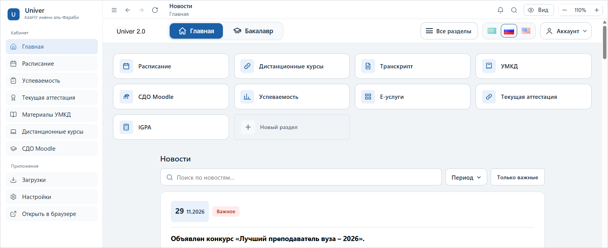
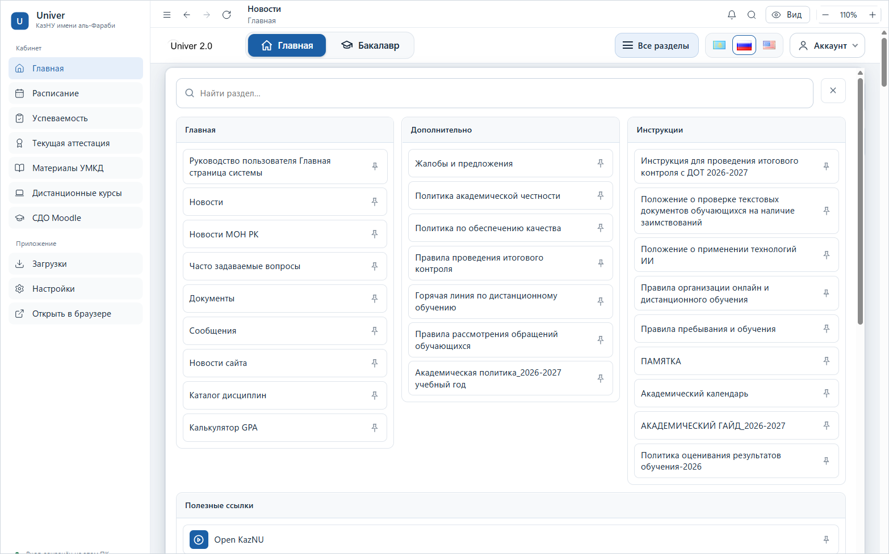
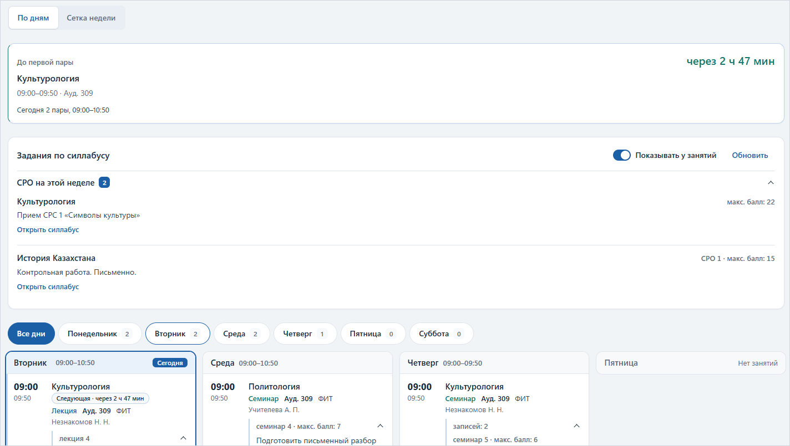
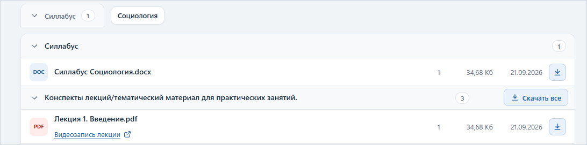
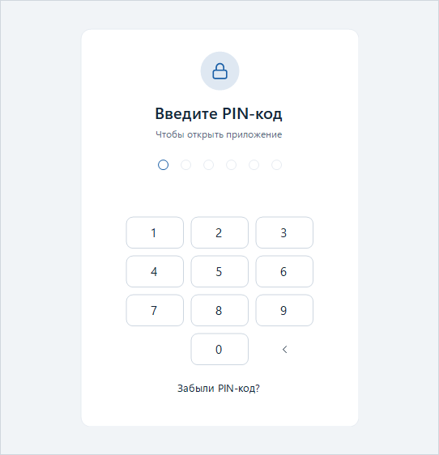

[Русский](README.md) · [Қазақша](README.kz.md) · **English**

# Simple Univer for Windows

> **Unofficial app.** It is not affiliated with or supported by Al-Farabi Kazakh National University. Sign-in, data and forms stay on [univer.kaznu.kz](https://univer.kaznu.kz/): the app opens the real website in a built-in Chromium browser and makes it easier to use on a computer.

A desktop app for the [Univer KazNU](https://univer.kaznu.kz/) student portal with the same features as the Simple Univer Android app. The interface is built for mouse and keyboard and is available in Russian, Kazakh and English.

[](https://github.com/SSSox/Simple-UniverKazNU-Desktop/releases/latest) [](https://github.com/SSSox/Simple-UniverKazNU-Desktop/releases) [](LICENSE)

**[Download the latest version](https://github.com/SSSox/Simple-UniverKazNU-Desktop/releases/latest)** · [Which file to download](#which-file-to-download) · [Download site](https://sssox.github.io/SimpleUniver/) · [Privacy](PRIVACY.en.md) · [Security](SECURITY.en.md)



## Features

### The portal, easier to use

- **Saved sign-in.** Your login and password are stored encrypted on this computer; when the session ends, the app signs in again by itself.
- **Reading mode for the site:** readable tables and cards, one header instead of three bars, an "All sections" panel with search, pinned links on the home page. "View → Original layout" shows the site as it is.
- **Site notifications** about questionnaires and tests in the bell on the toolbar; questionnaires you have already answered are not counted.
- **Ctrl+F search** on site pages and in open files, news with search and filters.
- Light and dark theme, zoom, printing, running from the notification area (tray). You can have it start with Windows, straight into the tray without a window (Settings → App; off by default).



### Schedule and studies

- **Schedule** with the current and next class, a day filter and a week grid.
- **Class reminders.** Fifteen minutes before a class starts, the app shows a tray notification with the class and its room. In Settings you can pick 5, 10, 15 or 30 minutes or turn reminders off. They work while the app is running, also from the tray, and come from the copy of this week's schedule that the app keeps when you open the schedule or the Bachelor page, so the site gets no extra request for them. With a PIN set, the notification does not name the class. Exams and midterms get reminders too: the evening before at 19:00 and the same lead before the start, from a copy of the exam schedule the app keeps when you open the exam or midterm schedule page. Consultations get none. The tray icon's tooltip shows the next class ("Today, 11:00 · Philosophy"; without its name under a PIN), and "Schedule" in the icon's menu opens the schedule.
- **Start page** (Settings → Language & view): with a saved sign-in the app opens straight on the chosen section: home, Bachelor (the summary of today's classes, grades and the week's work), schedule, journal, current attestation, UMKD materials or distance learning. Without a saved sign-in it opens the home page.
- **Schedule without internet.** When the site cannot be reached, the app shows its saved copy of this week's schedule and when it was saved instead of the error page, with today marked. Retry and the automatic retries stay in the bar at the top. The copy is refreshed when the app signs in by itself and the schedule or Bachelor page is open. Below it come the coming exams and midterms from their schedule pages and the last course totals from the journal on the Bachelor page; each part has its own saved time, and when one copy is missing the others still show.
- **Offline entry.** When the site answers with an error or signing in takes longer than 20 seconds, the bar at the top offers "Open offline" (next to Retry when there is an error). It opens the same screen with the saved schedule, exams and grades without stopping the sign-in or sending anything to the site. Once the site opens again, the app goes back to it by itself; the screen also has "Back to the site" and "Try signing in again". The offer appears only when the app signs in by itself and a copy for that login exists. While the window is locked with a PIN, neither the screen nor the offer shows.
- **Schedule to a calendar or as a picture.** On the schedule page, «To calendar» saves an .ics file to Downloads for Google Calendar, Outlook or a phone calendar, and «As picture» saves a PNG. The file holds the week shown and its neighbour. The site alternates odd and even weeks, so the calendar repeats each of them every second week until the semester's last week. The app reads the neighbouring week from the site when you press the button; if it cannot be read, the file holds only the week shown and the app says so. Times are written as the site shows them, without a time zone. Later changes on the site do not reach the calendar by themselves: save the file again. Each class has a fixed identifier, so a calendar that uses them updates the classes on a second import instead of adding copies.
- **New grades.** While the app is running, also from the tray, it reads the Current attestation page every 30 minutes and shows in the tray which scores changed since the last check: the course and its new score, for example «Algorithms: RK2 96». The first check and a new list of courses (another semester, another site language) bring no notification. In Settings you can pick 15, 30, 60 or 120 minutes or turn the check off. It needs a saved sign-in; with a PIN set, the notification names no course or score. A successful check extends the site session, but the site can still end it; the app then signs in again if the sign-in is saved.
- **Syllabus tasks on the schedule.** Each class shows the topic of its week from the syllabus written for your educational programme, and the week's independent work is listed by course. When your group has seminars in other weeks than the syllabus says, the topics go to the classes in order, and independent work is named under the nearest seminar. Teacher consultations are left out. A topic folds on its own button, and one switch hides them all. Once you have opened the current week's schedule, its independent work also shows on the Bachelor (Бакалавр) page until the week ends.
- **Grades** by subject, clear assessment pages, all distance-course tasks on one page. The colour of a score shows where it stands against 50, 70 and 90, and the points left to the next mark are written beside it. You can pick a goal (Satisfactory, Good or Excellent), and then each midterm shows the points still missing for that goal. A subject with absences in the journal (the «н» marks) shows how many, and more than 25 missed hours in a term puts a warning over the subjects.
- **Grade summary** (the «Print and PDF» button on the grades page): every subject on one sheet with a key to the colours, clear enough for parents. The sheet names the chosen goal and the points left to it. Print it, save it to Downloads as PDF or PNG, or copy it as a picture for a messenger. With many subjects the PNG is split into several pictures, each with its own Copy button.



### Files

- **"Downloads" (Ctrl+J):** every downloaded file with search and filters, and a built-in viewer for PDF, Word, Excel, PowerPoint, web pages, text and images, without Office. The chosen sort order (newest, by name, by size) is kept for the next start. "Delete file" in a row's menu moves the file to the Windows Recycle Bin after you confirm; on a drive without a Recycle Bin (USB stick, network folder) the app does not delete it, and if the Recycle Bin is off or the file is too big for it, Windows itself asks whether to delete it for good.
- **"Download all"** in a section of the course materials (УМКД): the section's files go to Downloads, into the folder `Univer УМКД\<course>\<section>`. Files that were not on the course page at your last visit are marked New (in the app only).



### Sign-in protection

- **PIN** ("Sign-in protection" in Settings): the app asks for it at start and after a minute with the window minimized, hidden in the tray or Windows locked. After ten wrong attempts the app signs out and deletes the saved login.



There is no personal data in the screenshots. They show the Russian interface.

## Which file to download

Ready-made files are on the [Releases](../../releases) page. Every version comes in four variants, each in two forms: an installer (`-setup.exe`) and a portable archive (`.zip`).

| Your Windows | Variant | Installer | Portable |
| --- | --- | --- | --- |
| Windows 10 / 11, 64-bit | Modern x64 | `Univer-Desktop-<version>-modern-x64-setup.exe` | `Univer-Desktop-<version>-modern-x64.zip` |
| Windows 10, 32-bit | Modern x86 | `Univer-Desktop-<version>-modern-x86-setup.exe` | `Univer-Desktop-<version>-modern-x86.zip` |
| Windows 7 SP1 / 8 / 8.1, 64-bit | Legacy x64 | `Univer-Desktop-<version>-legacy-x64-setup.exe` | `Univer-Desktop-<version>-legacy-x64.zip` |
| Windows 7 SP1 / 8 / 8.1, 32-bit | Legacy x86 | `Univer-Desktop-<version>-legacy-x86-setup.exe` | `Univer-Desktop-<version>-legacy-x86.zip` |

You can see whether your Windows is 32- or 64-bit in "Settings → System → About → System type". If unsure, take Modern x64 on Windows 10/11.

**Modern or Legacy.** Modern runs on current Chromium 152 (CefSharp 152.0.150) and is meant for Windows 10 and 11. Legacy exists only for Windows 7 SP1, 8 and 8.1: Chromium 110 and later do not run on these systems, so Legacy uses Chromium 109 (CefSharp 109.1.110). **Chromium 109 has known vulnerabilities and gets no more updates** ([GHSA-f87w-3j5w-v58p](https://github.com/advisories/GHSA-f87w-3j5w-v58p)). The app reminds you of this at startup and in its settings. Do not use Legacy on Windows 10/11.

**Installer or portable.** The installer puts the app into the current user's profile, creates shortcuts and an uninstall entry in the Windows app list, and offers to download missing Microsoft components. The portable archive installs nothing: unpack it into any folder and run it from there. Both have the same features.

## Browser extension

On macOS, Linux, ChromeOS, Windows on ARM, or wherever you would rather not install the app, the Simple Univer extension for Chrome, Edge and Firefox gives the site the same look. It works only on `https://univer.kaznu.kz` and runs the same page scripts as the app: reading mode, schedule, attendance, grades and their summary, «Download all» in UMKD, pinned sections, the dark theme, and confirming the read notice and the agreement.

The extension keeps no password: the browser's password manager remembers it, and the site's own button signs in. It does not restore an expired session, does not show files inside itself, and saves the grade summary as PDF through the browser's print dialog, without PNG. Permissions: `storage` and access to `https://univer.kaznu.kz/*`; it has no access to other sites. What it stores is described in [its privacy policy](https://sssox.github.io/SimpleUniver/privacy/).

Until the extension is in the stores, Chrome and Edge can install it by hand: unpack `Univer-Extension-<version>-chromium.zip` into a folder you will keep (releases newer than 0.15.0 on the [Releases](../../releases) page carry it, or build it with [BUILD.en.md](BUILD.en.md)), open `chrome://extensions` (in Edge `edge://extensions`), turn on developer mode and click «Load unpacked». Firefox keeps an unsigned extension only until it restarts, so it needs the signed version. Firefox also opens every downloaded PDF in a tab by default; for «Download all» to only save files, set the PDF action to «Save File» in Firefox settings, under «Files and Applications». All files and store links are on the download site [sssox.github.io/SimpleUniver](https://sssox.github.io/SimpleUniver/).

## Checking the downloaded file

Every file in a release has a `.sha256` file next to it with its SHA-256 checksum. Compare it with the checksum of the downloaded file:

```powershell
Get-FileHash .\Univer-Desktop-<version>-modern-x64-setup.exe
```

The `Hash` value must match the line in `.sha256`. If it does not, do not run the file.

The files are **not signed** with a publisher certificate, so Windows SmartScreen may show "Windows protected your PC" or "Unknown publisher". Run only a file whose checksum matched: "More info → Run anyway".

## Installation

1. Run the `-setup.exe` of the variant you need. Administrator rights are not required: the app goes to `%LOCALAPPDATA%\Programs\Univer\<variant>` (for example `modern-x64`).
2. Choose the installer language (Russian, Kazakh or English). The app's own language is chosen separately, in its settings.
3. If the computer lacks the required .NET Framework or Visual C++ Redistributable, the installer lists them and asks whether to download them. The files come only from official Microsoft addresses, are checked against a pinned SHA-256 and run after you confirm; Windows may ask for administrator rights to install them. If a restart is needed afterwards, restart Windows and run the Univer installer again.
4. A shortcut is created in the Start menu; a desktop shortcut can be enabled during installation.

The installer checks the system before copying files: Modern installs on Windows 10 and later, Legacy on Windows 7 SP1 and later, x64 only on 64-bit Windows. ARM64 is not supported.

**Silent installation** (the Microsoft components must already be installed): `Univer-Desktop-<version>-modern-x64-setup.exe /VERYSILENT /SUPPRESSMSGBOXES /SP- /NORESTART /TASKS=""`.

## Portable, without installation

1. Install the Microsoft components if you do not have them yet (table below).
2. Unpack the ZIP **completely** into a separate folder. `Univer.Desktop.exe` alone, without the DLLs next to it, the `Assets` and `locales` folders and the Chromium resources, will not start.
3. Run `Univer.Desktop.exe`.

Sign-in data and settings are kept in your Windows profile (`%LOCALAPPDATA%\Univer.Desktop`), not in the program folder, so the portable folder can be moved or deleted.

## Requirements

| Variant | .NET Framework | Visual C++ Redistributable |
| --- | --- | --- |
| Modern x64 / x86 | 4.6.2 or later (usually already present on Windows 10/11) | 2015–2022 (14.44 or later): [x64](https://aka.ms/vs/17/release/vc_redist.x64.exe) / [x86](https://aka.ms/vs/17/release/vc_redist.x86.exe) |
| Legacy x64 / x86 | [4.5.2](https://www.microsoft.com/en-us/download/details.aspx?id=42642) or later (on Windows 8.0 only 4.5.2: 4.8 does not support it) | 2015–2019 (14.29 or later): [x64](https://aka.ms/vs/16/release/vc_redist.x64.exe) / [x86](https://aka.ms/vs/16/release/vc_redist.x86.exe) |

The Visual C++ package must match the variant, not only Windows: Modern x86 needs the x86 package even on 64-bit Windows. Old Windows 7/8 may need the TLS 1.2, SHA-2 and root certificate updates for HTTPS; the app does not turn off certificate checks to work around their absence.

## Updating and uninstalling

The installed app checks GitHub by itself at every start, and while it stays open at most once every 6 hours. When a new version is out, a window offers Later and Install and a "Don't show again" checkbox, which hides the window for that version only. The check always runs; its result and the same buttons are in Settings → Updates. After Install, Univer downloads the installer of its variant, verifies the SHA-256, closes, installs the new version and opens again.

You can also update by hand: close Univer (in the tray too) and run the installer of the new version of **the same variant** over the old one. Sign-in, settings and the downloads list are kept. The installer does not let you install an older version over a newer one. Modern, Legacy, x64 and x86 go into different folders and do not interfere with each other, but two variants cannot run at the same time.

Portable also tells you about a new version but does not update itself: the button opens the release page. Unpack the new archive into a new folder and delete the old one.

Uninstalling: "Settings → Apps → Univer → Uninstall". The program is removed, while its data stays in `%LOCALAPPDATA%\Univer.Desktop` and downloaded files stay in your Downloads folder. To remove everything:

1. Before uninstalling, open "Settings → Account → Sign out": your login and password are removed from this computer.
2. After uninstalling, delete the `%LOCALAPPDATA%\Univer.Desktop` folder.

## First start

On the first start the app offers two ways to sign in: enter your Univer login and password in the app window (they are then saved encrypted and sign-in happens by itself), or sign in manually on the site page without saving anything. After that the app reuses the saved session.

If settings are missing, damaged or temporarily unreadable, the saved password remains encrypted and automatic sign-in waits for an explicit "Sign in again". A settings read error cannot undo a previous sign-out.

- "Settings → Account → Sign out" ends the session, clears cookies and removes the saved login and password from this computer. The app language stays as it was.
- The sign-out link on the site itself only ends the session: the password stays saved, and automatic sign-in waits until you press "Sign in again" in "Settings → Account".
- If your password changed on the site, the app stops after two rejections in a row and asks for the new one.

With a saved sign-in the app itself confirms only two site dialogs that would otherwise block the portal: the read notice after sign-in and the additional agreement dialog with the "прочитал договор" (I have read the contract) checkbox. In both cases it ticks the checkbox and presses the site's own button. The app submits no other forms and confirms nothing else. Details: [SECURITY.en.md](SECURITY.en.md).

## Reporting a fault

In Settings → App → File for a fault report, the Save button puts a text file in your Downloads folder and opens the folder. The file holds the app and Chromium versions, the Windows version, the screen and window size, the settings (on or off, numbers), the address of the open page without its parameters and numbers, and the last errors of this run. It has no login, password, cookies, page text, grades or other portal data, and the Windows user name, computer name, e-mail addresses, long numbers and tokens are replaced with markers. The app never sends this file anywhere: attach it to your report yourself.

## Keyboard shortcuts

| Action | Keys |
| --- | --- |
| Back / close the open document | Alt+←, Esc, the mouse's Back side button |
| Forward in the site | Alt+→, the mouse's Forward side button |
| "Downloads" | Ctrl+J |
| Search on the page, in a document or file | Ctrl+F |
| Next / previous match | F3 or Enter / Shift+F3 or Shift+Enter |
| Reload the page (forms are never resent) | F5, Ctrl+R |
| Settings | Ctrl+, |
| All sections with the cursor in the search | Ctrl+K |
| Print | Ctrl+P |
| Zoom 100% / in / out | Ctrl+0 / Ctrl+plus / Ctrl+minus, Ctrl+mouse wheel |

## What has been tested

The app was tested on Windows 11 x64, including the 32-bit builds on the same system. It was not tested on Windows 7, 8, 8.1 and 10, on a separate 32-bit Windows, on ARM64, with non-standard display scaling or on several monitors. It depends on the site: if the university changes its pages, parts of the reading mode may stop working until the app is updated; "Original layout" shows the site unchanged.

## Privacy and security

The app has no server of its own, no analytics, telemetry or crash reports. Its own requests go only to `https://univer.kaznu.kz` and to GitHub, where updates come from; links to other sites open in a separate panel inside the app with its own browser profile, or in your browser if you turn on "Open links in an external browser". The password is stored on this computer, encrypted with Windows DPAPI for your account.

- [PRIVACY.en.md](PRIVACY.en.md): what data is stored, where, and how to delete it.
- [Extension privacy](https://sssox.github.io/SimpleUniver/privacy/): what the browser extension stores.
- [SECURITY.en.md](SECURITY.en.md): what the app does and does not do, its limitations and how to report a vulnerability.

## Code signing policy

Release files are not signed yet. The project is applying for free code signing through [SignPath Foundation](https://signpath.org).

Only files that GitHub Actions builds from this repository ([`release.yml`](.github/workflows/release.yml)) will be signed: `Univer.Desktop.exe` and the installers. Chromium and CefSharp files and the Inno Setup uninstaller are third-party components and do not get this signature.

- Authors and reviewers: [SSSox](https://github.com/SSSox).
- Approver of every signature: [SSSox](https://github.com/SSSox).
- Privacy: [PRIVACY.en.md](PRIVACY.en.md).

## How the app works

It is a C# WinForms app (.NET Framework, C# 7.3) with Chromium built in through [CefSharp](https://github.com/cefsharp/CefSharp). The site opens as in an ordinary browser; the app adds its own layout and sign-in scripts to its pages and shows its own windows around it.

| Folder | Contents |
| --- | --- |
| `src/Univer.Desktop/Program.cs` | Startup, Chromium settings |
| `src/Univer.Desktop/Core/` | Rules: which address is trusted (`SitePolicy.cs`), data storage and encryption (`Storage.cs`), file names, document converters for the viewer, notifications |
| `src/Univer.Desktop/Web/` | Chromium handlers, download checks (`DownloadService.cs`, `SessionHttp.cs`), sign-in automation (`AutomationController.cs`) |
| `src/Univer.Desktop/UI/` | Windows, settings, "Downloads", translations (`Strings.cs`); `UI/Qa/`: built-in self-test on synthetic pages |
| `src/Univer.Desktop/Assets/` | JavaScript added to the site's pages: layout, sign-in, schedule, notifications; `pdfjs/`: Mozilla PDF.js for viewing PDF |
| `src/Univer.Extension/` | The extension for Chrome, Edge and Firefox: manifest, settings popup and the scripts that do in the browser what the C# part does; `scripts/build-extension.ps1` takes the page scripts from `Assets/` unchanged |
| `tests/` | xUnit tests for the C# code, jsdom tests for the pages and the extension; `tests/extension/`: checks of the extension in real Chrome and Firefox; no real accounts |
| `scripts/` | Build, packaging, installer and checks ([BUILD.en.md](BUILD.en.md)) |
| `installer/` | Inno Setup installer source and pinned Microsoft components |
| `licenses/` | Third-party licenses ([THIRD-PARTY.en.md](THIRD-PARTY.en.md)) |

## Building from source

You need Windows 10/11, the .NET SDK (tested with 10.0.400) and PowerShell 7. Users of the ready-made app do not need them.

```powershell
# Portable Modern x64 into a new artifacts\release-<date> folder
.\scripts\build-release.ps1 -Package Portable
# All four variants, portable and installers, with a check of the unpacked archives
.\scripts\build-release.ps1 -Package Both -BrowserFlavor all -Platform all -Verify
```

Tests, the step-by-step build, the installer and a description of every script: [BUILD.en.md](BUILD.en.md).

## License

Copyright (C) 2026 the Univer · KazNU authors.

The code is distributed under the [GNU General Public License](LICENSE), version 3 or, at your option, any later version (GPL-3.0-or-later). You may use, modify and distribute it, including for a fee, but a modified version of the app must be released under the same license together with its source code. The source code of every version is the release tag in this repository; a source archive is on the release page.

Third-party components (CefSharp, Chromium Embedded Framework, Mozilla PDF.js, Lucide) keep their own licenses, listed in [THIRD-PARTY.en.md](THIRD-PARTY.en.md); the texts are in `licenses/` and next to the PDF.js files. The name, logo and materials of Al-Farabi KazNU are not covered by the license and belong to the university.
