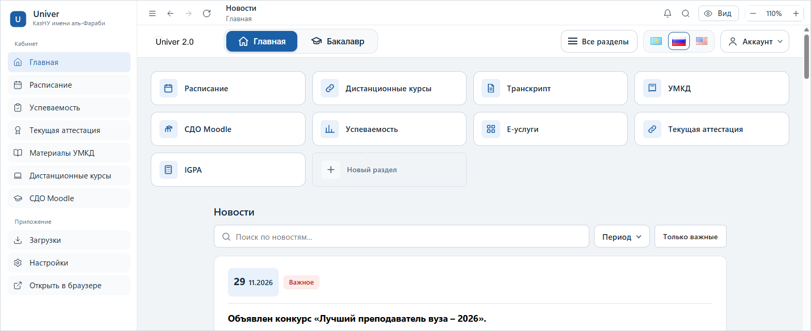
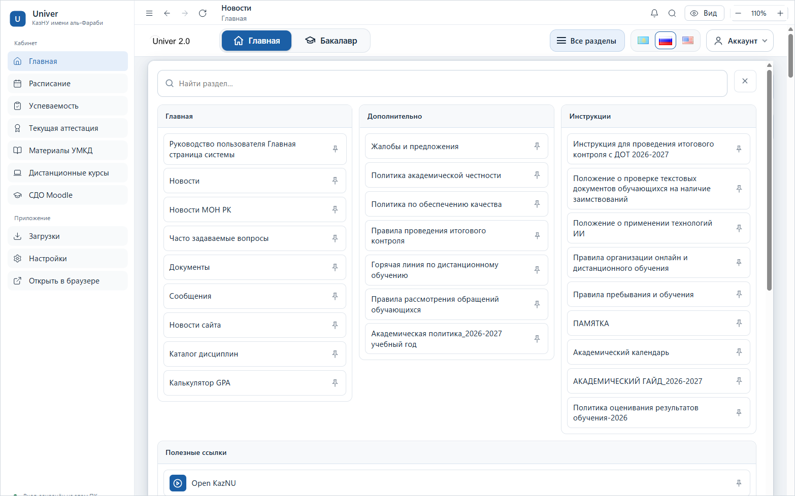
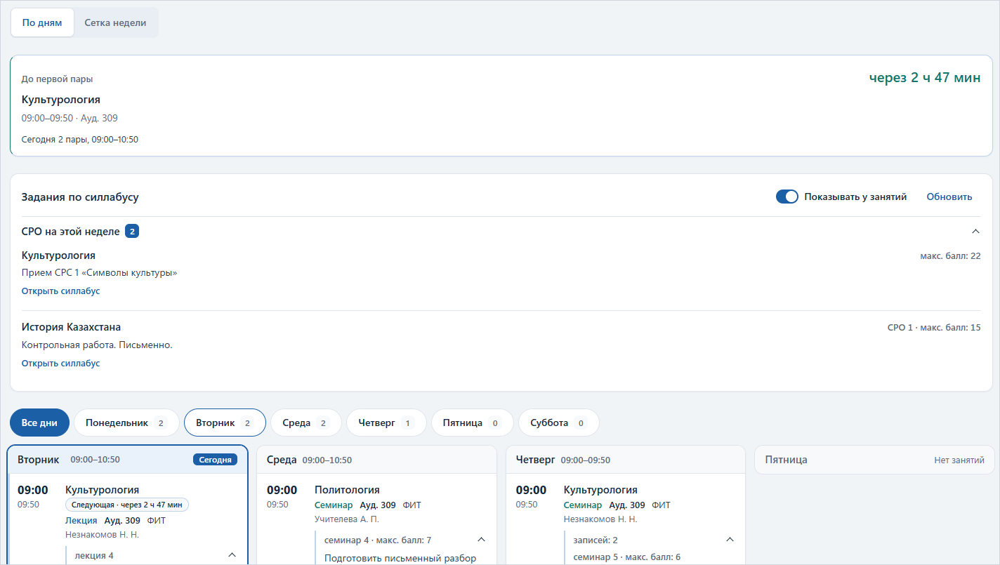
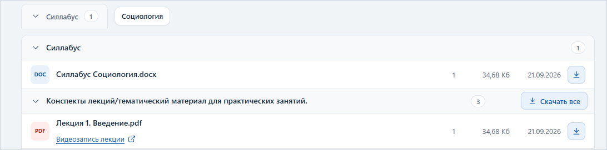
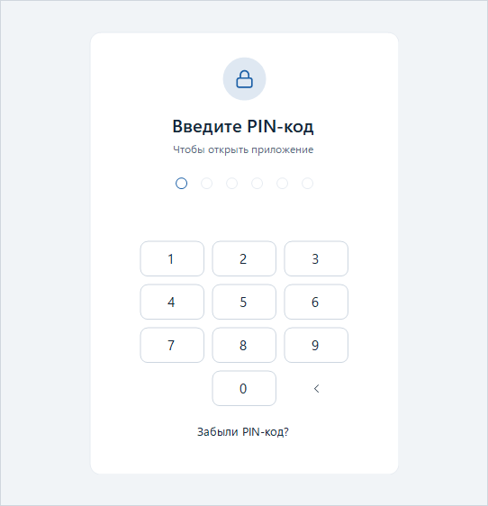

[Русский](README.md) · **Қазақша** · [English](README.en.md)

# Windows үшін Simple Univer

> **Ресми емес қолданба.** Әл-Фараби атындағы ҚазҰУ-ға қатысы жоқ және университет қолдамайды. Кіру, деректер мен пішіндер [univer.kaznu.kz](https://univer.kaznu.kz/) сайтында қалады: қолданба нағыз сайтты кірістірілген Chromium браузерінде ашып, оны компьютерде пайдалануға ыңғайлы етеді.

[Univer ҚазҰУ](https://univer.kaznu.kz/) студент кабинетіне арналған жұмыс үстелі қолданбасы, мүмкіндіктері Android-тағы Simple Univer қолданбасымен бірдей. Интерфейс тінтуір мен пернетақтаға арналған, орыс, қазақ және ағылшын тілдерінде.

[](https://github.com/SSSox/Simple-UniverKazNU-Desktop/releases/latest) [](https://github.com/SSSox/Simple-UniverKazNU-Desktop/releases) [](LICENSE)

**[Соңғы нұсқаны жүктеу](https://github.com/SSSox/Simple-UniverKazNU-Desktop/releases/latest)** · [Қай файлды жүктеу керек](#қай-файлды-жүктеу-керек) · [Жүктеу сайты](https://sssox.github.io/SimpleUniver/) · [Құпиялылық](PRIVACY.kz.md) · [Қауіпсіздік](SECURITY.kz.md)



## Мүмкіндіктер

### Ыңғайлы кабинет

- **Сақталған кіру.** Логин мен құпиясөз осы компьютерде шифрланып сақталады; сессия аяқталғанда қолданба өзі қайта кіреді.
- **Сайттың ыңғайлы көрінісі:** оқуға жеңіл кестелер мен карточкалар, үш жолақтың орнына бір тақырып, іздеуі бар «Барлық бөлімдер» панелі, басты беттегі бекітілген сілтемелер. «Көрініс → Түпнұсқа көрініс» сайтты өзгеріссіз көрсетеді.
- **Сайт хабарландырулары** сауалнамалар мен тесттер туралы, құралдар тақтасындағы қоңыраушада; жауап берілген сауалнамалар есептелмейді.
- **Ctrl+F арқылы іздеу** сайт беттерінде және ашық файлдарда, іздеуі мен сүзгілері бар жаңалықтар.
- Ашық және қараңғы тақырып, масштаб, басып шығару, хабарландыру аймағынан (науадан) жұмыс. Windows-пен бірге іске қосуды қосуға болады: қолданба терезесіз, бірден науада ашылады (баптаулар → «Қолданба»; әдепкіде өшірулі).



### Сабақ кестесі және оқу

- **Сабақ кестесі:** қазіргі және келесі сабақ, күндер бойынша сүзгі және апта торы.
- **Сабақ туралы еске салу.** Сабақ басталардан 15 минут бұрын қолданба науада сабақ атауы мен дәрісханасы жазылған хабарландыру көрсетеді. Баптауларда 5, 10, 15 не 30 минутты таңдауға немесе еске салуды өшіруге болады. Ол қолданба іске қосулы тұрғанда (науада да) жұмыс істейді және сіз кестені не «Бакалавр» бетін ашқанда қолданба сақтайтын апта кестесінің көшірмесінен алынады; бұл үшін сайтқа бөлек сұрау жіберілмейді. PIN-код орнатылса, хабарландыруда қай сабақ екені жазылмайды.
- **Интернетсіз кесте.** Сайтпен байланыс болмаса, қате бетінің орнына қолданба апта кестесінің сақталған көшірмесін және оның қашан сақталғанын көрсетеді; бүгінгі күн белгіленеді. «Қайталау» мен автоматты қайталау жоғарғы жолақта қалады. Көшірме қолданба сайтқа өзі кіргенде, кесте не «Бакалавр» беті ашылғанда жаңарады.
- **Кесте күнтізбеге немесе сурет ретінде.** Кесте бетіндегі «Күнтізбеге» батырмасы Google Күнтізбесіне, Outlook-қа не телефон күнтізбесіне арналған .ics файлын «Жүктеулер» бумасына сақтайды, ал «Сурет ретінде» PNG сақтайды. Файлға көрсетілген апта мен көрші апта кіреді. Сайт тақ және жұп апталарды кезектестіреді, сондықтан күнтізбе әрқайсысын семестрдің соңғы аптасына дейін бір апта аралатып қайталайды. Көрші аптаны қолданба батырма басылған сәтте сайттан оқиды; оны оқу мүмкін болмаса, файлда тек көрсетілген апта болады және қолданба бұл туралы айтады. Уақыт сайттағыдай, уақыт белдеуінсіз жазылады. Сайттағы өзгерістер күнтізбеге өздігінен түспейді: файлды қайта сақтаңыз. Әр сабақтың тұрақты идентификаторы бар, сондықтан оларды ескеретін күнтізбе қайта импорттағанда сабақтарды көшірмесін қоспай жаңартады.
- **Жаңа бағалар.** Қолданба іске қосулы тұрғанда (науада да) 30 минут сайын «Ағымдағы аттестация» бетін оқиды және соңғы тексеруден бері қай балдар өзгергенін науада көрсетеді: пән мен жаңа балл, мысалы «Алгоритмдер: АБ2 96». Бірінші тексеру мен пәндердің жаңа тізімі (басқа семестр, сайттың басқа тілі) хабарландыру бермейді. Баптауларда 15, 30, 60 не 120 минутты таңдауға немесе тексеруді өшіруге болады. Сақталған кіру керек; PIN-код орнатылса, хабарландыруда пән мен балл жазылмайды. Әр тексеру сайттағы сессияны ұзартады, сондықтан қолданба ашық тұрғанда сессия аяқталмайды.
- **Кестедегі силлабус тапсырмалары.** Әр сабақтың астында өз білім беру бағдарламаңыздың силлабусынан сол аптаның тақырыбы көрінеді, ал аптаның БӨЖ тапсырмалары пәндер бойынша бір тізімде. Топтың семинарлары силлабустағыдан басқа апталарда өтсе, тақырыптар сабақтарға ретімен беріледі, ал БӨЖ ең жақын семинардың астында аталады. Кеңестер (ОБӨЖ) көрсетілмейді. Тақырыпты жасыруға, барлығын бір ауыстырғышпен өшіруге болады. Ағымдағы аптаның кестесін ашқаннан кейін оның БӨЖ-і апта біткенше «Бакалавр» бетінде де көрінеді.
- **Үлгерім** пәндер бойынша, түсінікті аттестация беттері, қашықтан оқыту курстарының тапсырмалары бір бетте. Балдың түсі оның 50, 70 және 90 шектеріне қатысты қай жерде екенін көрсетеді, ал жанында келесі шекке дейін қанша қалғаны жазылады. Мақсатты таңдауға болады («Қанағаттанарлық», «Жақсы» не «Өте жақсы»): сонда әр АБ үшін дәл соған дейін қанша балл жетпейтіні көрінеді. Журналда қатыспаған сабақтар («н» белгісі) болса, пәнде олардың саны көрсетіледі.
- **Үлгерім қорытындысы** (үлгерім бетіндегі «Басып шығару және PDF» батырмасы): барлық пән бір парақта, түстердің түсіндірмесімен, ата-анаға да түсінікті. Парақта таңдалған мақсат пен оған дейін қалған балдар жазылады. Оны басып шығаруға, «Жүктеулер» бумасына PDF немесе PNG етіп сақтауға не мессенджерге жіберу үшін сурет ретінде көшіруге болады. Пән көп болса, PNG бірнеше суретке бөлінеді, әрқайсысының өз «Көшіру» батырмасы бар.



### Файлдар

- **«Жүктеулер» (Ctrl+J):** жүктелген барлық файл, іздеу мен сүзгілер, PDF, Word, Excel, PowerPoint, веб-беттерді, мәтін мен суреттерді Office-сыз көрсететін кірістірілген қарау құралы.
- **«Барлығын жүктеу»** ОӘК материалдарының бөлімінде: бөлім файлдары «Жүктеулер» ішіндегі `Univer УМКД\<пән>\<бөлім>` бумасына сақталады. Курс бетіне соңғы кіргеннен кейін пайда болған файлдар «Жаңа» деп белгіленеді (тек қолданбада).



### Кіруді қорғау

- **PIN-код** (баптаулардағы «Кіруді қорғау»): қолданба оны іске қосқанда, сондай-ақ терезе жиылғаннан, науаға жасырылғаннан немесе Windows құлыпталғаннан бір минут өткен соң сұрайды. Он рет қате енгізілсе, қолданба аккаунттан шығып, сақталған кіру деректерін жояды.



Суреттерде жеке деректер жоқ. Суреттердегі интерфейс орыс тілінде.

## Қай файлды жүктеу керек

Дайын файлдар [Releases](../../releases) бетінде. Әр нұсқа төрт түрде шығады, әрқайсысы екі пішінде: орнатушы (`-setup.exe`) және портативті мұрағат (`.zip`).

| Сіздің Windows | Нұсқа | Орнатушы | Портативті |
| --- | --- | --- | --- |
| Windows 10 / 11, 64 разрядты | Modern x64 | `Univer-Desktop-<нұсқа>-modern-x64-setup.exe` | `Univer-Desktop-<нұсқа>-modern-x64.zip` |
| Windows 10, 32 разрядты | Modern x86 | `Univer-Desktop-<нұсқа>-modern-x86-setup.exe` | `Univer-Desktop-<нұсқа>-modern-x86.zip` |
| Windows 7 SP1 / 8 / 8.1, 64 разрядты | Legacy x64 | `Univer-Desktop-<нұсқа>-legacy-x64-setup.exe` | `Univer-Desktop-<нұсқа>-legacy-x64.zip` |
| Windows 7 SP1 / 8 / 8.1, 32 разрядты | Legacy x86 | `Univer-Desktop-<нұсқа>-legacy-x86-setup.exe` | `Univer-Desktop-<нұсқа>-legacy-x86.zip` |

Windows разрядтылығын «Параметрлер → Жүйе → Туралы → Жүйе түрі» бөлімінен көруге болады. Күмәндансаңыз, Windows 10/11-де Modern x64 нұсқасын алыңыз.

**Modern әлде Legacy.** Modern заманауи Chromium 152 (CefSharp 152.0.150) негізінде жұмыс істейді және Windows 10 бен 11-ге арналған. Legacy тек Windows 7 SP1, 8 және 8.1 үшін бар: 110 нұсқасынан бастап Chromium бұл жүйелерде жұмыс істемейді, сондықтан Legacy Chromium 109 (CefSharp 109.1.110) пайдаланады. **Chromium 109-да белгілі осалдықтар бар және оған жаңартулар енді шықпайды** ([GHSA-f87w-3j5w-v58p](https://github.com/advisories/GHSA-f87w-3j5w-v58p)). Қолданба бұл туралы іске қосылғанда және баптауларда ескертеді. Windows 10/11-де Legacy пайдаланбаңыз.

**Орнатушы әлде портативті.** Орнатушы қолданбаны ағымдағы пайдаланушы профиліне орнатады, жарлықтар мен Windows қолданбалар тізімінде жою жазбасын жасайды және жетіспейтін Microsoft компоненттерін жүктеуді өзі ұсынады. Портативті мұрағат ештеңе орнатпайды: оны кез келген бумаға ашып, сол жерден іске қосыңыз. Мүмкіндіктері бірдей.

## Браузер кеңейтуі

macOS, Linux, ChromeOS, ARM-дағы Windows жүйелерінде немесе қолданбаны орнатқыңыз келмесе, сайтқа дәл сондай көріністі Chrome, Edge және Firefox үшін Simple Univer кеңейтуі береді. Ол тек `https://univer.kaznu.kz` сайтында жұмыс істейді және қолданбадағы бет скрипттерін іске қосады: ыңғайлы көрініс, сабақ кестесі, сабаққа қатысу, бағалар және олардың жиынтығы, ОӘК-тегі «Барлығын жүктеу», бекітілген бөлімдер, қараңғы тақырып, хабарландыру мен келісімді растау.

Кеңейту құпиясөзді сақтамайды: оны браузердің құпиясөз менеджері есте сақтайды, ал сайттың өз батырмасы кіреді. Мерзімі өткен сессияны кеңейту қалпына келтірмейді, файлдарды өз ішінде көрсетпейді, ал бағалар жиынтығын браузердің басып шығару терезесі арқылы PDF түрінде сақтайды, PNG жоқ. Рұқсаттар: `storage` және `https://univer.kaznu.kz/*` сайтына қатынау, басқа сайттарға қатынауы жоқ. Кеңейту не сақтайтыны [оның құпиялылық саясатында](https://sssox.github.io/SimpleUniver/privacy/) жазылған.

Кеңейту дүкендерде пайда болғанша Chrome мен Edge оны қолмен орната алады: `Univer-Extension-<нұсқа>-chromium.zip` мұрағатын тұрақты бумаға ашыңыз (мұрағат [Releases](../../releases) бетінде 0.15.0-ден жаңа шығарылымдарда бар, оны [BUILD.kz.md](BUILD.kz.md) бойынша құрастыруға да болады), `chrome://extensions` бетін ашып (Edge-де `edge://extensions`), әзірлеуші режимін қосыңыз және «Ашылған кеңейтуді жүктеу» батырмасын басыңыз. Firefox қол қойылмаған кеңейтуді тек қайта іске қосылғанша сақтайды, сондықтан оған қол қойылған нұсқа керек. Сондай-ақ Firefox әдепкі бойынша жүктелген әр PDF файлын қойындыда ашады; «Барлығын жүктеу» файлдарды тек сақтауы үшін Firefox баптауларының «Файлдар мен қолданбалар» бөлімінде PDF үшін «Файлды сақтау» әрекетін таңдаңыз. Барлық файлдар мен дүкен сілтемелері [sssox.github.io/SimpleUniver](https://sssox.github.io/SimpleUniver/) жүктеу сайтында.

## Жүктелген файлды тексеру

Шығарылымдағы әр файлдың жанында оның SHA-256 бақылау сомасы жазылған `.sha256` файлы бар. Оны жүктелген файлдың сомасымен салыстырыңыз:

```powershell
Get-FileHash .\Univer-Desktop-<нұсқа>-modern-x64-setup.exe
```

`Hash` мәні `.sha256` ішіндегі жолмен сәйкес келуі керек. Сәйкес келмесе, файлды іске қоспаңыз.

Файлдар баспагер сертификатымен **қол қойылмаған**, сондықтан Windows SmartScreen «Windows компьютеріңізді қорғады» немесе «Белгісіз баспагер» деп көрсетуі мүмкін. Тек сомасы сәйкес келген файлды іске қосыңыз: «Толығырақ → Бәрібір іске қосу».

## Орнату

1. Қажетті нұсқаның `-setup.exe` файлын іске қосыңыз. Әкімші құқығы қажет емес: қолданба `%LOCALAPPDATA%\Programs\Univer\<нұсқа>` бумасына орнатылады (мысалы, `modern-x64`).
2. Орнатушы тілін таңдаңыз (орыс, қазақ немесе ағылшын). Қолданбаның өз тілі оның баптауларында бөлек таңдалады.
3. Компьютерде .NET Framework немесе Visual C++ Redistributable қажетті нұсқасы болмаса, орнатушы тізімін көрсетіп, оларды жүктеу керек пе деп сұрайды. Файлдар тек Microsoft-тың ресми мекенжайларынан алынады, бекітілген SHA-256 бойынша тексеріледі және сіз растағаннан кейін ғана іске қосылады; оларды орнату үшін Windows әкімші құқығын сұрауы мүмкін. Осыдан кейін қайта іске қосу қажет болса, Windows-ты қайта іске қосып, Univer орнатушысын қайта іске қосыңыз.
4. «Бастау» мәзірінде жарлық жасалады; жұмыс үстеліндегі жарлықты орнату кезінде қосуға болады.

Орнатушы файлдарды көшірмес бұрын жүйені тексереді: Modern Windows 10 және жаңарағына, Legacy Windows 7 SP1 және жаңарағына, x64 тек 64 разрядты Windows-қа орнатылады. ARM64 қолдау көрсетілмейді.

**Үнсіз орнату** (Microsoft компоненттері алдын ала орнатылған болуы керек): `Univer-Desktop-<нұсқа>-modern-x64-setup.exe /VERYSILENT /SUPPRESSMSGBOXES /SP- /NORESTART /TASKS=""`.

## Орнатусыз портативті нұсқа

1. Microsoft компоненттері әлі жоқ болса, оларды орнатыңыз (төмендегі кесте).
2. ZIP мұрағатын бөлек бумаға **толық** ашыңыз. Жанындағы DLL файлдарынсыз, `Assets`, `locales` бумаларынсыз және Chromium ресурстарынсыз жалғыз `Univer.Desktop.exe` іске қосылмайды.
3. `Univer.Desktop.exe` файлын іске қосыңыз.

Кіру деректері мен баптаулар бағдарлама бумасында емес, Windows профилінде (`%LOCALAPPDATA%\Univer.Desktop`) сақталады, сондықтан портативті буманы жылжытуға және жоюға болады.

## Жұмысқа не қажет

| Нұсқа | .NET Framework | Visual C++ Redistributable |
| --- | --- | --- |
| Modern x64 / x86 | 4.6.2 немесе жаңарағы (Windows 10/11-де әдетте бар) | 2015–2022 (14.44 немесе жаңарағы): [x64](https://aka.ms/vs/17/release/vc_redist.x64.exe) / [x86](https://aka.ms/vs/17/release/vc_redist.x86.exe) |
| Legacy x64 / x86 | [4.5.2](https://www.microsoft.com/en-us/download/details.aspx?id=42642) немесе жаңарағы (Windows 8.0-де тек 4.5.2: 4.8 оған сәйкес келмейді) | 2015–2019 (14.29 немесе жаңарағы): [x64](https://aka.ms/vs/16/release/vc_redist.x64.exe) / [x86](https://aka.ms/vs/16/release/vc_redist.x86.exe) |

Visual C++ разрядтылығы тек Windows-қа емес, нұсқаға сәйкес болуы керек: Modern x86 үшін 64 разрядты жүйеде де x86 пакеті қажет. Ескі Windows 7/8 жүйелерінде HTTPS үшін TLS 1.2, SHA-2 және түбірлік сертификаттар жаңартулары қажет болуы мүмкін; олар болмаған жағдайда қолданба сертификат тексеруін өшірмейді.

## Жаңарту және жою

Орнатылған қолданба GitHub-ты әр іске қосылғанда өзі тексереді, ал ашық тұрғанда 6 сағатта бір реттен жиі емес. Жаңа нұсқа шықса, «Кейінірек» және «Орнату» батырмалары мен «Қайта көрсетпеу» белгісі бар терезе ашылады: белгі терезені тек осы нұсқа үшін жасырады. Тексеру әрқашан жұмыс істейді, оның нәтижесі мен сол батырмалар «Баптаулар → Жаңартулар» ішінде бар. «Орнату» басылғанда Univer өз нұсқасының орнатушысын жүктейді, SHA-256 сәйкестігін тексереді, жабылады, жаңа нұсқаны орнатады және қайта ашылады.

Қолмен де жаңартуға болады: Univer-ді жабыңыз (науада да) және жаңа нұсқаның **сол нұсқадағы** орнатушысын ескісінің үстінен іске қосыңыз. Кіру, баптаулар мен жүктеулер тізімі сақталады. Орнатушы жаңа нұсқаның үстінен ескісін орнатуға жол бермейді. Modern, Legacy, x64 және x86 әртүрлі бумаларға орнатылады және бір-біріне кедергі келтірмейді, бірақ екі нұсқаны бір уақытта іске қосуға болмайды.

Портативті нұсқа да жаңа нұсқа туралы хабарлайды, бірақ өзі жаңартылмайды: батырма шығарылым бетін ашады. Жаңа мұрағатты жаңа бумаға ашып, ескісін жойыңыз.

Жою: «Параметрлер → Қолданбалар → Univer → Жою». Бағдарлама жойылады, ал деректер `%LOCALAPPDATA%\Univer.Desktop` бумасында, жүктелген файлдар «Жүктеулер» бумасында қалады. Барлығын жою үшін:

1. Бағдарламаны жоймас бұрын «Баптаулар → Аккаунт → Аккаунттан шығу» ашыңыз: логин мен құпиясөз осы компьютерден жойылады.
2. Бағдарламаны жойғаннан кейін `%LOCALAPPDATA%\Univer.Desktop` бумасын жойыңыз.

## Алғаш іске қосу

Алғаш іске қосқанда қолданба кірудің екі жолын ұсынады: Univer логині мен құпиясөзін қолданба терезесіне енгізу (сонда олар шифрланып сақталады және кіру өзі орындалады) немесе ештеңе сақтамай сайт бетінде қолмен кіру. Кейін қолданба сақталған сессияны пайдаланады.

Баптаулар жоғалса, бүлінсе немесе уақытша оқылмаса, сақталған құпиясөз шифрланған күйде қалады, ал автоматты кіру «Қайта кіру» әрекетін күтеді. Баптауларды оқу қатесі бұрын таңдалған шығуды жоймайды.

- «Баптаулар → Аккаунт → Аккаунттан шығу» сессияны аяқтап, cookies файлдарын тазалайды және сақталған логин мен құпиясөзді осы компьютерден жояды. Қолданба тілі өзгермейді.
- Сайттың өзіндегі шығу сілтемесі тек сессияны аяқтайды: құпиясөз сақталып қалады, ал автоматты кіру «Баптаулар → Аккаунт» ішінде «Қайта кіру» басылғанша күтеді.
- Сайтта құпиясөз өзгерсе, қатарынан екі рет бас тартылғаннан кейін қолданба тоқтап, жаңасын сұрайды.

Кіру сақталған кезде қолданба сайттың кабинетті жауып тұратын тек екі терезесін өзі растайды: кіргеннен кейінгі «оқыдым» хабарламасын және «прочитал договор» (шартты оқыдым) белгісі бар қосымша келісім терезесін. Екі жағдайда да ол белгіні қойып, сайттың өз батырмасын басады. Басқа пішіндерді қолданба жібермейді және ештеңе растамайды. Толығырақ: [SECURITY.kz.md](SECURITY.kz.md).

## Қате туралы хабарлау

«Баптаулар → Қолданба → Қате туралы хабарламаға файл» ішіндегі «Сақтау» батырмасы мәтіндік файлды «Жүктеулер» бумасына салып, сол буманы ашады. Файлда қолданба мен Chromium нұсқасы, Windows нұсқасы, экран мен терезе өлшемі, баптаулар (қосулы не өшірулі, сандар), ашық беттің параметрлері мен нөмірлері жоқ мекенжайы және осы іске қосудағы соңғы қателер бар. Онда логин, құпиясөз, cookies, беттердің мәтіні, бағалар және кабинеттің басқа деректері жоқ, ал Windows пайдаланушысының аты, компьютер аты, e-mail мекенжайлары, ұзын нөмірлер мен токендер белгілермен ауыстырылады. Қолданба бұл файлды ешқайда жібермейді: оны хабарламаға өзіңіз тіркеңіз.

## Пернелер тіркесімі

| Әрекет | Пернелер |
| --- | --- |
| Артқа / ашық құжатты жабу | Alt+←, Esc |
| «Жүктеулер» | Ctrl+J |
| Беттен, құжаттан немесе файлдан іздеу | Ctrl+F |
| Келесі / алдыңғы сәйкестік | F3 немесе Enter / Shift+F3 немесе Shift+Enter |
| Бетті жаңарту (пішіндер қайта жіберілмейді) | F5 |
| Баптаулар | Ctrl+, |
| «Барлық бөлімдер», курсор іздеуде | Ctrl+K |
| Басып шығару | Ctrl+P |
| Масштаб 100% / үлкейту / кішірейту | Ctrl+0 / Ctrl+плюс / Ctrl+минус, Ctrl+тінтуір дөңгелегі |

## Не тексерілді

Қолданба Windows 11 x64-те, соның ішінде сол жүйедегі 32 разрядты құрастырмаларда тексерілді. Windows 7, 8, 8.1 және 10-да, бөлек 32 разрядты Windows-та, ARM64-те, стандартты емес экран масштабында және бірнеше мониторда тексерілмеген. Жұмысы сайтқа байланысты: университет беттерін өзгертсе, ыңғайлы көріністің бір бөлігі қолданба жаңартылғанға дейін істемей қалуы мүмкін; «Түпнұсқа көрініс» сайтты өзгеріссіз көрсетеді.

## Құпиялылық және қауіпсіздік

Қолданбаның өз сервері, аналитикасы, телеметриясы және ақаулар туралы есептері жоқ. Оның өз сұраулары тек `https://univer.kaznu.kz` мекенжайына және жаңартулар келетін GitHub-қа барады; басқа сайттардың сілтемелері қолданба ішіндегі өз браузер профилі бар бөлек панельде ашылады, ал «Сілтемелерді сыртқы браузерде ашу» қосулы болса, сіздің браузеріңізде ашылады. Құпиясөз осы компьютерде сіздің есептік жазбаңыз үшін Windows DPAPI арқылы шифрланып сақталады.

- [PRIVACY.kz.md](PRIVACY.kz.md): қандай деректер, қайда сақталады және оларды қалай жоюға болады.
- [Кеңейтудің құпиялылығы](https://sssox.github.io/SimpleUniver/privacy/): браузер кеңейтуі не сақтайды.
- [SECURITY.kz.md](SECURITY.kz.md): қолданба не істейді және не істемейді, шектеулері және осалдық туралы қалай хабарлау керек.

## Кодқа қол қою саясаты (Code signing policy)

Қазір шығарылым файлдарына қол қойылмаған. Жоба [SignPath Foundation](https://signpath.org) арқылы тегін қол қоюға өтінім береді.

Қол тек GitHub Actions осы репозиторийден құрастыратын файлдарға қойылады ([`release.yml`](.github/workflows/release.yml)): `Univer.Desktop.exe` және орнатушылар. Chromium мен CefSharp файлдары және Inno Setup жою бағдарламасы бұл қолды алмайды: олар бөгде компоненттер.

- Авторлар және өзгерістерді тексеру: [SSSox](https://github.com/SSSox).
- Әр қолды растау: [SSSox](https://github.com/SSSox).
- Құпиялылық: [PRIVACY.kz.md](PRIVACY.kz.md).

## Қолданба қалай құрылған

Бұл [CefSharp](https://github.com/cefsharp/CefSharp) арқылы кірістірілген Chromium бар C# WinForms қолданбасы (.NET Framework, C# 7.3). Сайт кәдімгі браузердегідей ашылады; қолданба оның беттеріне өз көрініс және кіру скрипттерін қосып, айналасында өз терезелерін көрсетеді.

| Бума | Ішінде не бар |
| --- | --- |
| `src/Univer.Desktop/Program.cs` | Іске қосу, Chromium баптаулары |
| `src/Univer.Desktop/Core/` | Ережелер: қай мекенжай сенімді (`SitePolicy.cs`), деректерді сақтау және шифрлау (`Storage.cs`), файл атаулары, қарау құралына арналған құжат түрлендіргіштері, хабарландырулар |
| `src/Univer.Desktop/Web/` | Chromium өңдегіштері, жүктеулерді тексеру (`DownloadService.cs`, `SessionHttp.cs`), кіруді автоматтандыру (`AutomationController.cs`) |
| `src/Univer.Desktop/UI/` | Терезелер, баптаулар, «Жүктеулер», аудармалар (`Strings.cs`); `UI/Qa/`: синтетикалық беттердегі кірістірілген өзін-өзі тексеру |
| `src/Univer.Desktop/Assets/` | Сайт беттеріне қосылатын JavaScript: көрініс, кіру, сабақ кестесі, хабарландырулар; `pdfjs/`: PDF қарауға арналған Mozilla PDF.js |
| `src/Univer.Extension/` | Chrome, Edge және Firefox кеңейтуі: manifest, баптаулар терезесі және браузерде C# бөлігінің жұмысын атқаратын скрипттер; бет скрипттерін `scripts/build-extension.ps1` `Assets/` бумасынан өзгертпей алады |
| `tests/` | C# коды үшін xUnit тесттері, беттер мен кеңейтуге арналған jsdom тесттері; `tests/extension/`: кеңейтуді нағыз Chrome мен Firefox-та тексеру; нағыз аккаунттарсыз |
| `scripts/` | Құрастыру, буып-түю, орнатушы және тексерулер ([BUILD.kz.md](BUILD.kz.md)) |
| `installer/` | Inno Setup орнатушысының бастапқы коды және бекітілген Microsoft компоненттері |
| `licenses/` | Үшінші тарап компоненттерінің лицензиялары ([THIRD-PARTY.kz.md](THIRD-PARTY.kz.md)) |

## Бастапқы кодтан құрастыру

Windows 10/11, .NET SDK (10.0.400 нұсқасында тексерілген) және PowerShell 7 қажет. Дайын қолданбаны пайдаланушыларға олар қажет емес.

```powershell
# Portable Modern x64 жаңа artifacts\release-<күн> бумасына
.\scripts\build-release.ps1 -Package Portable
# Барлық төрт нұсқа, портативті мұрағаттар мен орнатушылар, ашылған мұрағаттарды тексерумен
.\scripts\build-release.ps1 -Package Both -BrowserFlavor all -Platform all -Verify
```

Тесттер, қадамдық құрастыру, орнатушы және әр скрипттің сипаттамасы: [BUILD.kz.md](BUILD.kz.md).

## Лицензия

Copyright (C) 2026 Univer · ҚазҰУ авторлары.

Код [GNU General Public License](LICENSE) лицензиясының 3-нұсқасы немесе, сіздің таңдауыңыз бойынша, кез келген кейінгі нұсқасы (GPL-3.0-or-later) бойынша таратылады. Оны пайдалануға, өзгертуге және таратуға, соның ішінде ақылы түрде де болады, бірақ қолданбаның өзгертілген нұсқасын сол лицензиямен бастапқы кодымен бірге шығару керек. Әр нұсқаның бастапқы коды: осы репозиторийдегі шығарылым тегі, бастапқы код мұрағаты шығарылым бетінде бар.

Үшінші тарап компоненттері (CefSharp, Chromium Embedded Framework, Mozilla PDF.js, Lucide) өз лицензияларын сақтайды, олар [THIRD-PARTY.kz.md](THIRD-PARTY.kz.md) файлында көрсетілген; мәтіндері `licenses/` бумасында және PDF.js файлдарының жанында. Әл-Фараби атындағы ҚазҰУ атауы, логотипі мен материалдары лицензияға кірмейді және университетке тиесілі.
