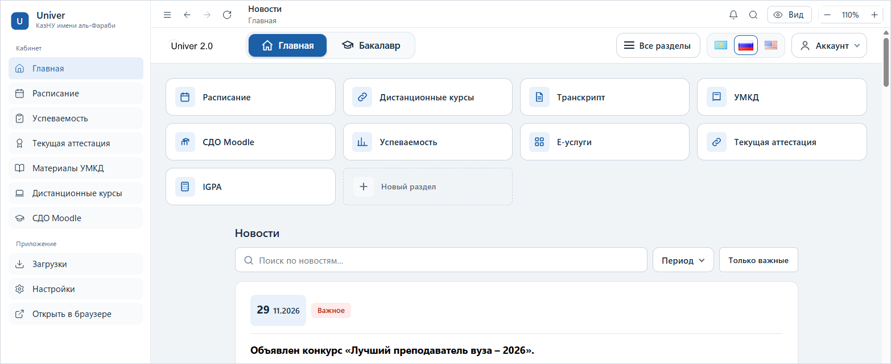
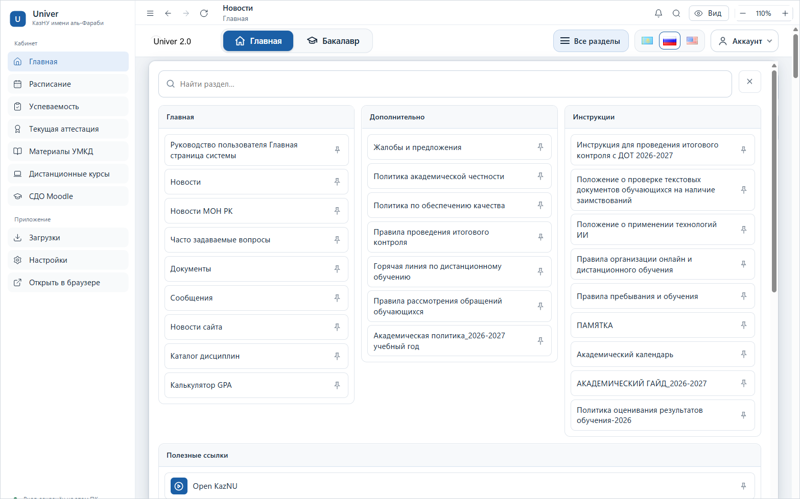
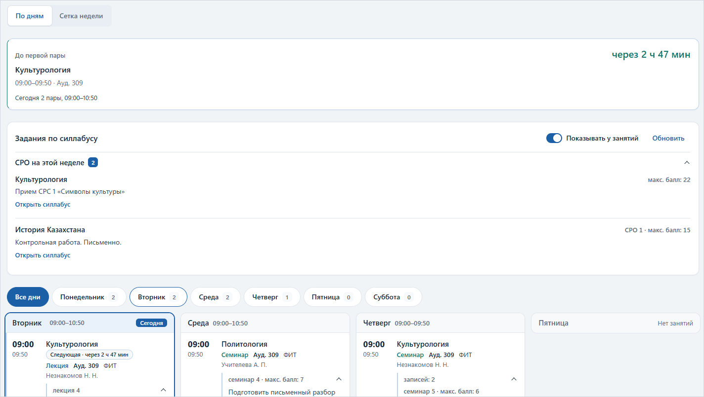
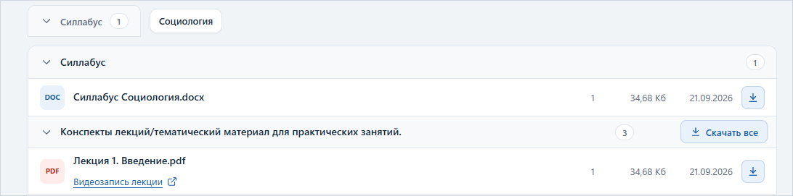
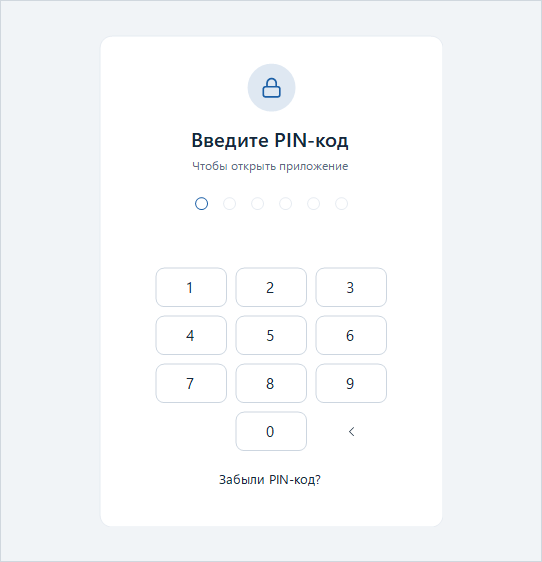

**Русский** · [Қазақша](README.kz.md) · [English](README.en.md)

# Simple Univer для Windows

> **Неофициальное приложение.** Не связано с КазНУ им. аль-Фараби и не поддерживается университетом. Вход, данные и формы остаются на сайте [univer.kaznu.kz](https://univer.kaznu.kz/): приложение открывает настоящий сайт во встроенном браузере Chromium и делает его удобнее на компьютере.

Настольное приложение для кабинета студента [Univer КазНУ](https://univer.kaznu.kz/) с теми же возможностями, что и Android-приложение Simple Univer. Интерфейс рассчитан на мышь и клавиатуру и переведён на русский, казахский и английский.

[](https://github.com/SSSox/Simple-UniverKazNU-Desktop/releases/latest) [](https://github.com/SSSox/Simple-UniverKazNU-Desktop/releases) [](LICENSE)

**[Скачать последнюю версию](https://github.com/SSSox/Simple-UniverKazNU-Desktop/releases/latest)** · [Какой файл скачать](#какой-файл-скачать) · [Сайт загрузок](https://sssox.github.io/SimpleUniver/) · [Приватность](PRIVACY.md) · [Безопасность](SECURITY.md)



## Возможности

### Кабинет в удобном виде

- **Сохранённый вход.** Логин и пароль хранятся зашифрованными на этом компьютере; после окончания сессии приложение входит снова само.
- **Удобный вид сайта:** читаемые таблицы и карточки, одна шапка вместо трёх полос, панель «Все разделы» с поиском, закреплённые ссылки на главной. «Вид → Оригинальный вид» возвращает сайт как есть.
- **Уведомления сайта** об анкетах и тестах в колокольчике на панели инструментов; отвеченные анкеты не считаются.
- **Поиск Ctrl+F** на странице сайта и в открытых файлах, новости с поиском и фильтрами.
- Светлая и тёмная тема, масштаб, печать, работа из области уведомлений (трея). Можно включить запуск вместе с Windows: приложение откроется сразу в трее, без окна (настройки → «Приложение»; по умолчанию выключено).



### Расписание и учёба

- **Расписание** с текущей и следующей парой, фильтром по дням и сеткой недели.
- **Напоминание о паре.** За 15 минут до начала пары приложение показывает уведомление в трее с названием пары и аудиторией. В настройках можно выбрать 5, 10, 15 или 30 минут или выключить напоминания. Они работают, пока приложение запущено (в том числе в трее), и берутся из копии расписания недели, которую приложение сохраняет, когда вы открываете расписание или страницу «Бакалавр»; отдельно сайт для этого не запрашивается. Если задан PIN-код, уведомление не называет пару. Так же приложение напоминает об экзаменах и рубежном контроле: накануне в 19:00 и за то же время до начала, по копии расписания экзаменов, которую оно сохраняет, когда вы открываете страницу расписания экзаменов или рубежного контроля. Консультации не напоминаются. Подсказка значка в трее показывает ближайшую пару («Сегодня, 11:00 · Философия»; с PIN-кодом без названия), а пункт «Расписание» в меню значка открывает расписание.
- **Стартовая страница** («Настройки → Язык и вид»): при сохранённом входе приложение открывается сразу на выбранном разделе: главная, расписание, журнал, текущая аттестация, материалы УМКД или дистанционное обучение. Без сохранённого входа открывается главная.
- **Расписание без интернета.** Если нет связи с сайтом, вместо страницы ошибки приложение показывает сохранённую копию расписания недели и время, когда она сохранена; сегодняшний день отмечен. «Повторить» и автоматические повторы остаются в полосе сверху. Копия обновляется, когда приложение само входит на сайт и открыта страница расписания или «Бакалавр». Под расписанием показаны последние итоги по предметам из журнала, которые приложение видело на странице «Бакалавр», со временем их сохранения; если копии расписания нет, на экране остаются только они.
- **Расписание в календарь или картинкой.** На странице расписания кнопка «В календарь» сохраняет в «Загрузки» файл .ics для Google Календаря, Outlook или календаря телефона, а «Картинкой» сохраняет PNG. В файл попадают показанная неделя и соседняя. Сайт чередует нечётные и чётные недели, поэтому календарь повторяет каждую из них через неделю до последней недели семестра. Соседнюю неделю приложение читает с сайта в момент нажатия; если прочитать её не удалось, в файле только показанная неделя, и приложение об этом говорит. Время записано так, как на сайте, без часового пояса. Изменения на сайте в календарь сами не попадают: сохраните файл заново. У каждой пары постоянный идентификатор, поэтому календарь, который их учитывает, при повторном импорте обновит пары, а не добавит копии.
- **Новые оценки.** Пока приложение запущено (в том числе в трее), оно раз в 30 минут читает страницу «Текущая аттестация» и показывает в трее, какие баллы изменились с прошлой проверки: предмет и новый балл, например «Алгоритмы: РК2 96». Первая проверка и новый список предметов (другой семестр, другой язык сайта) уведомлений не дают. В настройках можно выбрать 15, 30, 60 или 120 минут или выключить проверку. Нужен сохранённый вход; если задан PIN-код, уведомление не называет предмет и баллы. Каждая проверка продлевает сессию на сайте, так что, пока приложение открыто, сессия не заканчивается.
- **Задания по силлабусу в расписании.** Под каждой парой видна тема её недели из силлабуса вашей образовательной программы, а СРО недели собраны в один список по предметам. Если у группы семинары идут не в те недели, что в силлабусе, темы раздаются парам по порядку, а СРО показаны под ближайшим семинаром. Консультации (СРОП) не показываются. Тему можно свернуть, все темы можно скрыть одним переключателем. После того как вы открыли расписание текущей недели, её СРО видны и на странице «Бакалавр», пока неделя не кончится.
- **Успеваемость** по предметам, понятные страницы аттестации, задания «Дистанционных курсов» на одной странице. Цвет балла показывает, где он относительно порогов 50, 70 и 90, а рядом написано, сколько осталось до следующего. Можно выбрать цель («Удовлетворительно», «Хорошо» или «Отлично»): тогда у каждого РК видно, сколько баллов не хватает именно до неё. Если в журнале есть пропуски («н»), у предмета показано их число, а если за семестр пропущено больше 25 часов, над предметами появляется предупреждение.
- **Сводка успеваемости** (кнопка «Печать и PDF» на странице успеваемости): все предметы на одном листе с пояснением цветов, понятная и родителям. На листе указана выбранная цель и сколько баллов до неё осталось. Её можно распечатать, сохранить в «Загрузки» как PDF или PNG или скопировать картинкой для мессенджера. Если предметов много, PNG делится на несколько картинок, и у каждой своя кнопка «Копировать».



### Файлы

- **«Загрузки» (Ctrl+J):** все скачанные файлы с поиском и фильтрами и встроенный просмотр PDF, Word, Excel, PowerPoint, веб-страниц, текста и картинок без Office. Выбранная сортировка (новые, по имени, по размеру) сохраняется до следующего запуска. Пункт «Удалить файл» в меню строки после подтверждения переносит файл в корзину Windows; на дисках без корзины (флешка, сетевая папка) приложение файл не удаляет.
- **«Скачать все»** в разделе материалов УМКД: файлы раздела сохраняются в «Загрузки», в папку `Univer УМКД\<предмет>\<раздел>`. Файлы, которых не было при прошлом заходе на страницу курса, отмечены словом «Новый» (только в приложении).



### Защита входа

- **PIN-код** («Защита входа» в настройках): приложение спрашивает его при запуске и после минуты, когда окно свёрнуто, убрано в трей или Windows заблокирована. После десяти неверных попыток приложение выходит из аккаунта и удаляет сохранённый вход.



Личных данных на снимках нет.

## Какой файл скачать

Готовые файлы лежат на странице [Releases](../../releases). Для каждой версии есть четыре варианта, каждый в двух видах: установщик (`-setup.exe`) и portable-архив (`.zip`).

| Ваша Windows | Вариант | Установщик | Portable |
| --- | --- | --- | --- |
| Windows 10 / 11, 64-разрядная | Modern x64 | `Univer-Desktop-<версия>-modern-x64-setup.exe` | `Univer-Desktop-<версия>-modern-x64.zip` |
| Windows 10, 32-разрядная | Modern x86 | `Univer-Desktop-<версия>-modern-x86-setup.exe` | `Univer-Desktop-<версия>-modern-x86.zip` |
| Windows 7 SP1 / 8 / 8.1, 64-разрядная | Legacy x64 | `Univer-Desktop-<версия>-legacy-x64-setup.exe` | `Univer-Desktop-<версия>-legacy-x64.zip` |
| Windows 7 SP1 / 8 / 8.1, 32-разрядная | Legacy x86 | `Univer-Desktop-<версия>-legacy-x86-setup.exe` | `Univer-Desktop-<версия>-legacy-x86.zip` |

Разрядность Windows видна в «Параметры → Система → О системе → Тип системы». Если сомневаетесь, на Windows 10/11 берите Modern x64.

**Modern или Legacy.** Modern работает на современном Chromium 152 (CefSharp 152.0.150) и нужен для Windows 10 и 11. Legacy существует только для Windows 7 SP1, 8 и 8.1: начиная с версии 110 Chromium на этих системах не работает, поэтому Legacy использует Chromium 109 (CefSharp 109.1.110). **В Chromium 109 есть известные уязвимости, и обновлений для него больше не выходит** ([GHSA-f87w-3j5w-v58p](https://github.com/advisories/GHSA-f87w-3j5w-v58p)). Приложение напоминает об этом при запуске и в настройках. На Windows 10/11 Legacy не используйте.

**Установщик или portable.** Установщик ставит приложение в профиль текущего пользователя, создаёт ярлыки и пункт удаления в списке приложений Windows и сам предлагает скачать недостающие компоненты Microsoft. Portable-архив ничего не устанавливает: распакуйте его в любую папку и запускайте оттуда. Функции у обоих одинаковые.

## Расширение для браузера

На macOS, Linux, ChromeOS, Windows на ARM и там, где приложение ставить не хочется, тот же вид сайта даёт расширение Simple Univer для Chrome, Edge и Firefox. Оно работает только на `https://univer.kaznu.kz` и запускает те же скрипты страниц, что и приложение: удобный вид, расписание, посещаемость, оценки и их сводку, «Скачать все» в УМКД, закреплённые разделы, тёмную тему, подтверждение уведомления и соглашения.

Расширение не хранит пароль: его запоминает менеджер паролей браузера, а входит кнопка самого сайта. Сессию после истечения оно не восстанавливает, файлы не показывает у себя, а сводку оценок сохраняет в PDF через окно печати браузера, без PNG. Разрешения: `storage` и доступ к `https://univer.kaznu.kz/*`, к другим сайтам доступа нет. Что расширение хранит, описано в [его политике конфиденциальности](https://sssox.github.io/SimpleUniver/privacy/).

Пока расширения нет в магазинах, Chrome и Edge ставят его вручную: распакуйте `Univer-Extension-<версия>-chromium.zip` в постоянную папку (архив есть в выпусках новее 0.15.0 на странице [Releases](../../releases), его можно и собрать по [BUILD.md](BUILD.md)), откройте `chrome://extensions` (в Edge `edge://extensions`), включите режим разработчика и нажмите «Загрузить распакованное расширение». Firefox держит неподписанное расширение только до перезапуска, поэтому для него нужна подписанная версия. Ещё Firefox по умолчанию открывает каждый скачанный PDF во вкладке; чтобы «Скачать все» только сохраняла файлы, выберите для PDF действие «Сохранить файл» в настройках Firefox, раздел «Файлы и приложения». Все файлы и ссылки на магазины собраны на сайте загрузок [sssox.github.io/SimpleUniver](https://sssox.github.io/SimpleUniver/).

## Проверка скачанного файла

Рядом с каждым файлом в выпуске лежит файл `.sha256` с его контрольной суммой SHA-256. Сравните её с суммой скачанного файла:

```powershell
Get-FileHash .\Univer-Desktop-<версия>-modern-x64-setup.exe
```

Значение `Hash` должно совпасть со строкой в `.sha256`. Если не совпало, файл не запускайте.

Файлы **не подписаны** сертификатом издателя, поэтому Windows SmartScreen может показать «Windows защитила ваш компьютер» или «Неизвестный издатель». Запускайте только файл, сумма которого совпала: «Подробнее → Выполнить в любом случае».

## Установка

1. Запустите `-setup.exe` нужного варианта. Права администратора не нужны: приложение ставится в `%LOCALAPPDATA%\Programs\Univer\<вариант>` (например, `modern-x64`).
2. Выберите язык установщика (русский, казахский или английский). Язык самого приложения выбирается отдельно, в его настройках.
3. Если на компьютере нет нужной версии .NET Framework или Visual C++ Redistributable, установщик покажет список и спросит, скачать ли их. Файлы берутся только с официальных адресов Microsoft, проверяются по закреплённой SHA-256 и запускаются после вашего подтверждения; для их установки Windows может запросить права администратора. Если после них нужна перезагрузка, перезагрузите Windows и запустите установщик Univer ещё раз.
4. Ярлык создаётся в меню «Пуск»; ярлык на рабочем столе можно включить при установке.

Установщик проверяет систему до копирования файлов: Modern ставится на Windows 10 и новее, Legacy на Windows 7 SP1 и новее, x64 только на 64-разрядную Windows. ARM64 не поддерживается.

**Тихая установка** (компоненты Microsoft уже должны быть установлены): `Univer-Desktop-<версия>-modern-x64-setup.exe /VERYSILENT /SUPPRESSMSGBOXES /SP- /NORESTART /TASKS=""`.

## Portable без установки

1. Установите компоненты Microsoft, если их ещё нет (таблица ниже).
2. Распакуйте ZIP **полностью** в отдельную папку. Один `Univer.Desktop.exe` без соседних DLL, папок `Assets`, `locales` и ресурсов Chromium не запустится.
3. Запустите `Univer.Desktop.exe`.

Данные входа и настройки хранятся не в папке программы, а в профиле Windows (`%LOCALAPPDATA%\Univer.Desktop`), поэтому папку portable можно переносить и удалять.

## Что нужно для работы

| Вариант | .NET Framework | Visual C++ Redistributable |
| --- | --- | --- |
| Modern x64 / x86 | 4.6.2 или новее (на Windows 10/11 обычно уже есть) | 2015–2022 (14.44 или новее): [x64](https://aka.ms/vs/17/release/vc_redist.x64.exe) / [x86](https://aka.ms/vs/17/release/vc_redist.x86.exe) |
| Legacy x64 / x86 | [4.5.2](https://www.microsoft.com/en-us/download/details.aspx?id=42642) или новее (на Windows 8.0 только 4.5.2: 4.8 для неё не подходит) | 2015–2019 (14.29 или новее): [x64](https://aka.ms/vs/16/release/vc_redist.x64.exe) / [x86](https://aka.ms/vs/16/release/vc_redist.x86.exe) |

Разрядность Visual C++ должна совпадать с разрядностью варианта, а не только Windows: для Modern x86 нужен x86-пакет даже на 64-разрядной системе. На старых Windows 7/8 для HTTPS могут понадобиться обновления TLS 1.2, SHA-2 и корневых сертификатов; приложение не отключает проверку сертификатов, чтобы обойти их отсутствие.

## Обновление и удаление

Установленное приложение само проверяет GitHub при каждом запуске, а пока оно открыто, не чаще раза в 6 часов. Если вышла новая версия, появляется окно с кнопками «Позже» и «Установить» и галочкой «Больше не показывать»: она скрывает окно только для этой версии. Проверка работает всегда, её результат и те же кнопки есть в «Настройки → Обновления». После «Установить» Univer скачивает установщик своего варианта, сверяет SHA-256, закрывается, ставит новую версию и открывается снова.

Обновиться можно и вручную: закройте Univer (и в трее тоже) и запустите установщик новой версии **того же варианта** поверх старой. Вход, настройки и список загрузок сохраняются. Установщик не даёт поставить старую версию поверх новой. Modern, Legacy, x64 и x86 ставятся в разные папки и не мешают друг другу, но одновременно запустить два варианта нельзя.

Portable тоже сообщает о новой версии, но сам не обновляется: кнопка откроет страницу выпуска. Распакуйте новый архив в новую папку и удалите старую.

Удаление: «Параметры → Приложения → Univer → Удалить». Программа удаляется, а данные остаются в `%LOCALAPPDATA%\Univer.Desktop`, скачанные файлы остаются в папке «Загрузки». Чтобы удалить всё:

1. До удаления программы откройте «Настройки → Аккаунт → Выйти из аккаунта»: логин и пароль удалятся с компьютера.
2. После удаления программы удалите папку `%LOCALAPPDATA%\Univer.Desktop`.

## Первый запуск

При первом запуске приложение предлагает два способа войти: ввести логин и пароль Univer в окне приложения (тогда они сохраняются зашифрованными и вход выполняется сам) или войти вручную на странице сайта, ничего не сохраняя. Дальше приложение пользуется сохранённой сессией.

Если настройки пропали, повреждены или временно недоступны, сохранённый пароль остаётся зашифрованным, а автоматический вход ждёт явного «Войти снова». Ошибка чтения настроек не отменяет ранее выбранный выход.

- «Настройки → Аккаунт → Выйти из аккаунта» завершает сессию, очищает cookies и удаляет сохранённые логин и пароль с этого компьютера. Язык приложения не меняется.
- Ссылка «Выход» на самом сайте только завершает сессию: пароль остаётся сохранённым, а автовход ждёт, пока вы не нажмёте «Войти снова» в «Настройки → Аккаунт».
- Если пароль сменился на сайте, после двух отказов подряд приложение остановится и попросит ввести новый.

При сохранённом входе приложение само подтверждает только два окна сайта, которые иначе закрывают кабинет: уведомление о прочтении после входа и окно дополнительного соглашения с флажком «прочитал договор». В обоих случаях оно отмечает флажок и нажимает кнопку самого сайта. Других форм приложение не отправляет и ничего не подтверждает. Подробно: [SECURITY.md](SECURITY.md).

## Сообщить об ошибке

В «Настройки → Приложение → Файл для сообщения об ошибке» кнопка «Сохранить» кладёт текстовый файл в папку «Загрузки» и открывает папку с ним. В файле версия приложения и Chromium, версия Windows, размер экрана и окна, настройки (включено или выключено, числа), адрес открытой страницы без параметров и номеров и последние ошибки этого запуска. Логина, пароля, cookies, текста страниц, оценок и других данных кабинета в нём нет, а имя пользователя Windows, имя компьютера, адреса e-mail, длинные номера и токены заменяются пометками. Приложение никуда этот файл не отправляет: приложите его к сообщению сами.

## Горячие клавиши

| Действие | Клавиши |
| --- | --- |
| Назад / закрыть открытый документ | Alt+←, Esc, боковая кнопка мыши «Назад» |
| Вперёд по сайту | Alt+→, боковая кнопка мыши «Вперёд» |
| «Загрузки» | Ctrl+J |
| Поиск на странице, в документе или файле | Ctrl+F |
| Следующее / предыдущее совпадение | F3 или Enter / Shift+F3 или Shift+Enter |
| Обновить страницу (без повторной отправки форм) | F5, Ctrl+R |
| Настройки | Ctrl+, |
| «Все разделы» с курсором в поиске | Ctrl+K |
| Печать | Ctrl+P |
| Масштаб 100% / больше / меньше | Ctrl+0 / Ctrl+плюс / Ctrl+минус, Ctrl+колесо мыши |

## Что проверено

Приложение проверялось на Windows 11 x64, включая 32-разрядные сборки на этой же системе. На Windows 7, 8, 8.1 и 10, на отдельной 32-разрядной Windows, на ARM64, с нестандартным масштабом экрана и на нескольких мониторах оно не проверялось. Работа зависит от сайта: если университет изменит страницы, часть удобного вида может перестать работать до обновления приложения; «Оригинальный вид» показывает сайт без изменений.

## Приватность и безопасность

У приложения нет своего сервера, аналитики, телеметрии и отчётов о сбоях. Его собственные запросы идут только к `https://univer.kaznu.kz` и к GitHub, откуда приходят обновления; ссылки на другие сайты открываются в отдельной панели внутри приложения со своим профилем браузера, а если включить «Открывать ссылки во внешнем браузере», то в вашем браузере. Пароль хранится на этом компьютере, зашифрованный Windows DPAPI для вашей учётной записи.

- [PRIVACY.md](PRIVACY.md): какие данные хранятся, где и как их удалить.
- [SECURITY.md](SECURITY.md): что приложение делает и чего не делает, ограничения и как сообщить об уязвимости.
- [Конфиденциальность расширения](https://sssox.github.io/SimpleUniver/privacy/): что хранит расширение для браузера.

## Политика подписи кода (Code signing policy)

Сейчас файлы выпусков не подписаны. Проект подаёт заявку на бесплатную подпись через [SignPath Foundation](https://signpath.org).

Подписываться будут только файлы, которые GitHub Actions собирает из этого репозитория ([`release.yml`](.github/workflows/release.yml)): `Univer.Desktop.exe` и установщики. Файлы Chromium и CefSharp и программа удаления Inno Setup эту подпись не получают: это сторонние компоненты.

- Авторы и проверка изменений: [SSSox](https://github.com/SSSox).
- Подтверждение каждой подписи: [SSSox](https://github.com/SSSox).
- Приватность: [PRIVACY.md](PRIVACY.md).

## Как устроено приложение

Это WinForms-приложение на C# (.NET Framework, C# 7.3) со встроенным Chromium через [CefSharp](https://github.com/cefsharp/CefSharp). Сайт открывается как в обычном браузере; приложение добавляет к его страницам свои скрипты оформления и автоматизации входа и показывает свои окна вокруг.

| Папка | Что внутри |
| --- | --- |
| `src/Univer.Desktop/Program.cs` | Запуск, настройки Chromium |
| `src/Univer.Desktop/Core/` | Правила: какой адрес доверенный (`SitePolicy.cs`), хранение и шифрование данных (`Storage.cs`), имена файлов, конвертеры документов для просмотра, уведомления |
| `src/Univer.Desktop/Web/` | Обработчики Chromium, проверка скачиваний (`DownloadService.cs`, `SessionHttp.cs`), автоматизация входа (`AutomationController.cs`) |
| `src/Univer.Desktop/UI/` | Окна, настройки, «Загрузки», переводы (`Strings.cs`); `UI/Qa/`: встроенная самопроверка на синтетических страницах |
| `src/Univer.Desktop/Assets/` | JavaScript, который добавляется к страницам сайта: вид, вход, расписание, уведомления; `pdfjs/`: Mozilla PDF.js для просмотра PDF |
| `src/Univer.Extension/` | Расширение для Chrome, Edge и Firefox: manifest, окно настроек и скрипты, которые делают в браузере работу C#-части; скрипты страниц `scripts/build-extension.ps1` берёт из `Assets/` без изменений |
| `tests/` | Тесты xUnit для C#-кода, тесты страниц и расширения на jsdom; `tests/extension/`: проверка расширения в настоящих Chrome и Firefox; без настоящих аккаунтов |
| `scripts/` | Сборка, упаковка, установщик и проверки ([BUILD.md](BUILD.md)) |
| `installer/` | Исходник установщика Inno Setup и закреплённые компоненты Microsoft |
| `licenses/` | Лицензии сторонних компонентов ([THIRD-PARTY.md](THIRD-PARTY.md)) |

## Сборка из исходников

Нужны Windows 10/11, .NET SDK (проверен 10.0.400) и PowerShell 7. Пользователям готового приложения они не нужны.

```powershell
# Portable Modern x64 в новую папку artifacts\release-<дата>
.\scripts\build-release.ps1 -Package Portable
# Все четыре варианта, portable и установщики, с проверкой распакованных архивов
.\scripts\build-release.ps1 -Package Both -BrowserFlavor all -Platform all -Verify
```

Тесты, пошаговая сборка, установщик и описание всех скриптов: [BUILD.md](BUILD.md).

## Лицензия

Copyright (C) 2026 авторы Univer · КазНУ.

Код распространяется по [GNU General Public License](LICENSE) версии 3 или, на ваш выбор, любой более поздней версии (GPL-3.0-or-later). Его можно использовать, изменять и распространять, в том числе за деньги, но изменённую версию приложения нужно выпускать под той же лицензией вместе с исходным кодом. Исходный код каждой версии: тег выпуска в этом репозитории, архив исходников есть на странице выпуска.

Сторонние компоненты (CefSharp, Chromium Embedded Framework, Mozilla PDF.js, Lucide) сохраняют свои лицензии, они перечислены в [THIRD-PARTY.md](THIRD-PARTY.md); тексты лежат в `licenses/` и рядом с файлами PDF.js. Название, логотип и материалы КазНУ им. аль-Фараби лицензией не охватываются и принадлежат университету.
